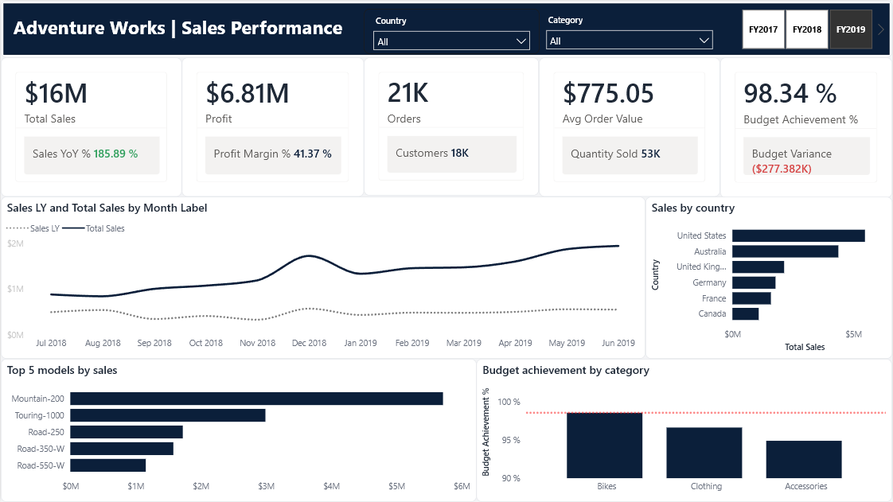

# Adventure Works \| Sales Performance & Profitability Dashboard

## Project Overview

This project is an interactive **Power BI dashboard** built to analyze
Adventure Works' sales performance, profitability, and budget
achievement.

The report is organized into two pages, providing a high-level sales
overview as well as a more detailed breakdown of profitability and
budget variances. Interactive slicers allow users to explore results by
country, product category, and fiscal year.

## Dashboard Pages

### 1. Sales Performance

This page provides an overview of the main sales and business
performance indicators.

**Key metrics** - Total Sales - Profit - Number of Orders - Average
Order Value - Budget Achievement %

**Analysis and visualizations** - Monthly sales trends and
year-over-year comparison - Sales performance by country - Top 5 product
models by sales - Budget achievement by product category

### 2. Profitability and Budget

This page focuses on product profitability and the comparison between
actual results and budget targets.

**Analysis and visualizations** - Sales, profit, and profit margin by
category and subcategory - Budget and budget achievement percentage -
Monthly variance versus budget - Actual sales versus budget trends over
time

## Interactive Features

-   Country slicer
-   Product category slicer
-   Fiscal year selection
-   Interactive charts and category-level drill-down

## Tools & Skills

-   Microsoft Power BI
-   DAX
-   Data Modeling
-   Data Visualization
-   KPI Development
-   Sales and Profitability Analysis
-   Budget Variance Analysis

## Dashboard Preview

### Sales Performance

### Profitability and Budget

## Project File

The Power BI report is available in this repository:

`rezome.pbix`

------------------------------------------------------------------------

**Author:** Alireza Shiri

